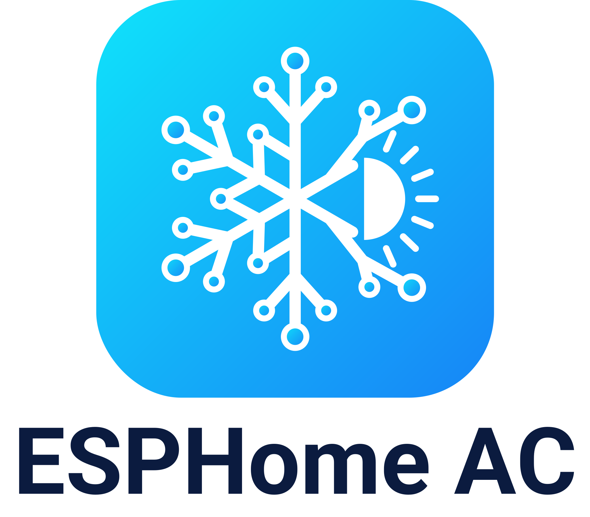

  <picture>
    <source media="(prefers-color-scheme: dark)" srcset="docs/logo-dark.png">
    <source media="(prefers-color-scheme: light)" srcset="docs/logo-light.png">
    
  </picture>

  
  
  
  

Replace your **Hisense** AC's Wi-Fi module (AEH-W4x / **AEH-W41H1**) with a small M5Stack ESP32
board and control it locally from Home Assistant. No cloud, no app.

Free for personal and non-commercial use. Forks welcome. Commercial use is not permitted.

  

[Wiring](docs/wiring.md) · [Configuration](docs/configuration.md) ·
[Compatibility](docs/compatibility.md) · [Protocol](brands/hisense/protocol.md) ·
[Changelog](CHANGELOG.md) · [Report a bug](https://github.com/skydoy/ESPHome_AC/issues/new/choose)

<!-- TODO: photo of the M5StickC Plus2 + RS485 Hat installed in the indoor unit (docs/img/installed.jpg) -->
<!-- TODO: GIF of the status screen cycling through states (docs/img/screen.gif) -->

## Hardware
| Board | What you get | Approx. price |
|---|---|---|
| [M5Stack ATOM Lite](https://docs.m5stack.com/en/core/ATOM%20Lite) + [ATOM Tail485](https://docs.m5stack.com/en/atom/tail485) | Cheapest. RGB status LED, button for status / factory reset | ≈ US$15 ($7.50 + $6.95) |
| [M5StickC Plus2](https://docs.m5stack.com/en/core/M5StickC%20PLUS2) + [RS485 Hat](https://docs.m5stack.com/en/hat/hat_rs485) | Status screen, two buttons (the Plus2 is end-of-life at the M5Stack shop) | ≈ US$28 ($19.95 + ≈ $8) |

Prices are M5Stack shop list prices, before shipping and tax. Wiring for both:
[docs/wiring.md](docs/wiring.md).

## Install in 3 steps
1. **Flash:** plug the board into your computer by USB, open the
   **[web installer](https://skydoy.github.io/ESPHome_AC/)** (Chrome or Edge), pick your board →
   *Connect* → *Install*. (ATOM: flash before fitting the Tail485, it uses the USB-C port.)
2. **Wire:** AC off at the breaker, measure the plug, connect it as shown below
   ([full guide](docs/wiring.md)).
3. **Connect:** join the `Hisense-AC Setup` Wi-Fi hotspot (or use Improv in the installer or
   over Bluetooth), then adopt the device in Home Assistant → **Settings → Devices → ESPHome**.

Updates then arrive over the air through the **Firmware Update** entity. If you adopt the device
in the ESPHome Device Builder, update it from there instead (the adopted config
has no update entity, so your settings are never replaced): change the release tag in its
`packages:` line, then press Install ([details](docs/configuration.md#esphome-device-builder)).
The firmware ships without an API key; to add one (recommended), see
[API encryption](docs/configuration.md#api-encryption-and-ota-password-optional).
Open `http://<device-ip>/` to see states and live logs (no password, LAN only;
[how to add one or turn it off](docs/configuration.md#web-server)).

> ⚠️ **G0 boot pin (Stick only):** if the Stick boots from USB but not from the AC, add a 10 kΩ pull-up from
> G0 to 3.3 V. [Details](docs/wiring.md#3-boot-pin-g0-read-this-before-closing-the-ac)

## Features
- Climate: Off / Cool / Heat / Dry / Fan / Auto, 16–32 °C, 7 fan speeds incl. Quiet, swing
- Presets: Eco, Boost, Sleep, 8 °C frost protection
- Sensors: room, outdoor and coil temperatures, compressor frequency, humidity, voltage,
  power, current, energy today (when the unit reports them)
- AEH-W41H1 link handshake and 82 / 150 / 160-byte status frames
- Diagnostics: link state, fault codes, reset reason
- Status screen (Stick) or RGB status LED (ATOM); OTA auto-update; `dashboard_import` adoption

## Links
| What | Where |
|---|---|
| Web installer | https://skydoy.github.io/ESPHome_AC/ |
| Wiring (5 V and 12 V) | [docs/wiring.md](docs/wiring.md) |
| Configuration, entities, screen | [docs/configuration.md](docs/configuration.md) |
| Hisense notes and modules | [brands/hisense/README.md](brands/hisense/README.md) |
| Hardware details | [brands/hisense/hardware.md](brands/hisense/hardware.md) |
| Protocol | [brands/hisense/protocol.md](brands/hisense/protocol.md) |
| Adapters and other brands | [adapters/README.md](adapters/README.md) |
| Dashboard import / own build | [Stick](devices/hisense-m5stickc-plus2.yaml) / [ATOM](devices/hisense-atom-lite-tail485.yaml) device configs, [examples/](examples/my-ac-livingroom.yaml) |
| Contributing (new brands) | [CONTRIBUTING.md](CONTRIBUTING.md) |
| Compatible models and modules | [docs/compatibility.md](docs/compatibility.md) |
| Changelog and releases | [CHANGELOG.md](CHANGELOG.md), [Releases](https://github.com/skydoy/ESPHome_AC/releases) |
| Bug, feature or compatibility report | [New issue](https://github.com/skydoy/ESPHome_AC/issues/new/choose) |
| Questions | [Discussions](https://github.com/skydoy/ESPHome_AC/discussions) |
| Security | [SECURITY.md](SECURITY.md) |

Works with Hisense units whose Wi-Fi module sits on the 4-pin RS-485 connector; see the
[compatibility table](docs/compatibility.md) and
[tell us how it went](https://github.com/skydoy/ESPHome_AC/issues/new?template=compatibility_report.yml).
Only Hisense is supported today. Other brands (Mitsubishi, Daikin, Midea, …) wait for testers
with real hardware; see [CONTRIBUTING.md](CONTRIBUTING.md).

## Credits
Original implementation; no code copied. Protocol knowledge from
[AndrewDemsDS/hisense-w41h1](https://github.com/AndrewDemsDS/hisense-w41h1),
[akrabi/hisense_ac_esphome](https://github.com/akrabi/hisense_ac_esphome),
[Druidblack/AC-Hisense](https://github.com/Druidblack/AC-Hisense),
[pio2398/W4G2](https://github.com/pio2398/W4G2),
[zoffypal/esphome_hisence_ac](https://github.com/zoffypal/esphome_hisence_ac),
[straga/scrivo_project](https://github.com/straga/scrivo_project),
[pslawinski/esphome_airconintl](https://github.com/pslawinski/esphome_airconintl) and
[artshevchenko/AC-Hi](https://github.com/artshevchenko/AC-Hi).

## License
[PolyForm Noncommercial 1.0.0](LICENSE): free for personal and non-commercial use, forks
welcome, commercial use not permitted. Use at your own risk: the indoor unit has mains voltage inside. Hisense is a
trademark of its owner; this project is not affiliated with it.
