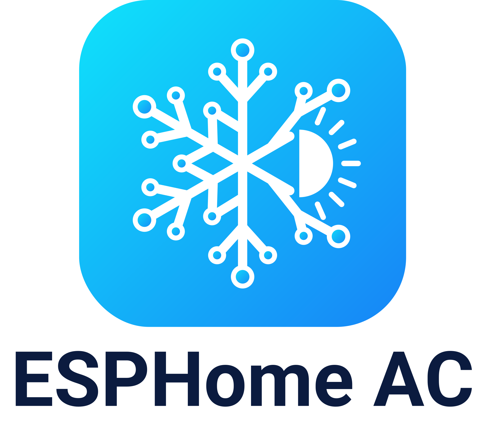
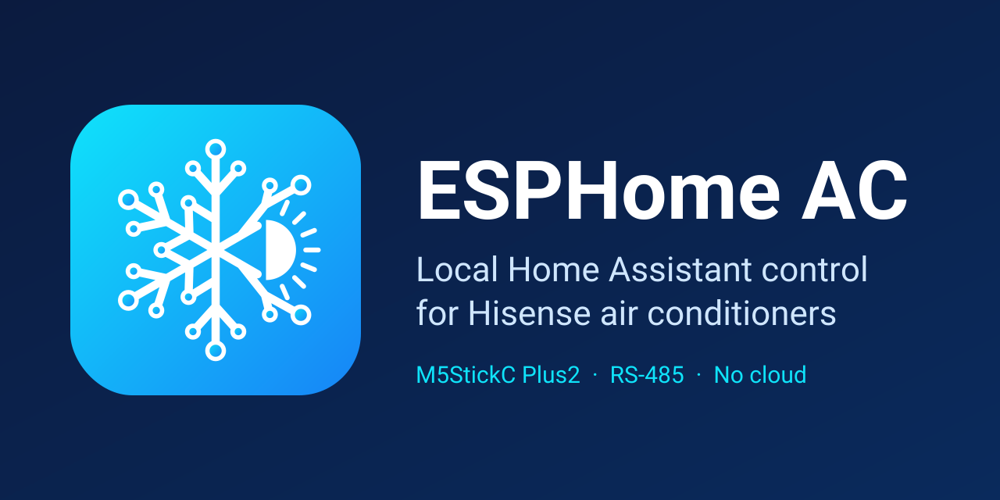

  <picture>
    <source media="(prefers-color-scheme: dark)" srcset="docs/logo-dark.png">
    <source media="(prefers-color-scheme: light)" srcset="docs/logo-light.png">
    
  </picture>

<b>Like it? Help me build something better.</b> 
  
  

  
  
  
  

<b>Your air conditioner in Home Assistant. Plug in by USB, click Install, done. No YAML.</b> 
🇵🇹 <a href="README.pt.md">Ler em português</a>

  

  

## Compatibility

**M5StickC Plus2 + RS485 Hat** or **ATOM Lite + ATOM Tail485**, on Hisense units with the **AEH-W4x / AEH-W41H1** Wi-Fi module (4-pin RS-485).  
Full list: [compatibility](docs/compatibility.md) · [Report my AC](https://github.com/skydoy/ESPHome_AC/issues/new?template=compatibility_report.yml)

## Install in 3 steps

1. **Flash** — Open the **[web installer](https://skydoy.github.io/ESPHome_AC/)**, pick your board, plug in by USB → **Install**.
2. **Wi-Fi** — Type your 2.4 GHz network in the same window (or join `ESPHome_AC Setup` later).
3. **Wire and add** — Breaker off, connect the 4-wire plug ([wiring](docs/wiring.md)), breaker on. Home Assistant → **Configure**.

Pictures: [Quick start](docs/quick-start.md)

## What you get

- Climate: Off / Cool / Heat / Dry / Fan / Auto, 16–32 °C, 7 fan speeds, swing, Eco / Boost / Sleep
- Sensors: outdoor & coil temps, compressor Hz, humidity, voltage, power, energy (when the unit reports them)
- AC Link / Fault, panel light, Eco / Super / Fan Mute / Sleep
- One-click firmware updates (or Auto Update at night)
- Device web page on your LAN (`http://<device-ip>/`) — [screenshots](docs/web-page.md)
- Local control only — no cloud for control; optional anonymous compatibility report

## Docs & more

[Overview (boards, OTA, credits)](docs/overview.md) ·
[Quick start](docs/quick-start.md) ·
[Wiring](docs/wiring.md) ·
[Home Assistant](docs/home-assistant.md) ·
[Configuration](docs/configuration.md) ·
[Troubleshooting](docs/troubleshooting.md) ·
[Compatibility](docs/compatibility.md) ·
[Device web page](docs/web-page.md) ·
[Security & OTA](docs/security.md) ·
[Hisense notes](brands/hisense/README.md) ·
[Changelog](CHANGELOG.md) ·
[Discussions](https://github.com/skydoy/ESPHome_AC/discussions)

[PolyForm Noncommercial 1.0.0](LICENSE) — free for personal and non-commercial use; commercial use not permitted.  
[Security policy](SECURITY.md) · [Third-party notices](THIRD_PARTY_NOTICES.md)
