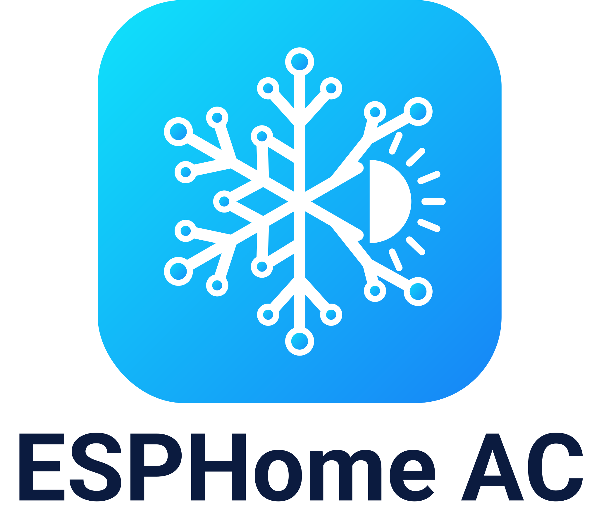

  <picture>
    <source media="(prefers-color-scheme: dark)" srcset="docs/logo-dark.png">
    <source media="(prefers-color-scheme: light)" srcset="docs/logo-light.png">
    
  </picture>

<b>Gostas? Ajuda-me a fazer algo ainda melhor.</b> 
  
  

  
  
  
  

<b>O seu ar condicionado no Home Assistant. Ligar por USB, carregar em Instalar, feito. Sem YAML.</b> 
🇬🇧 <a href="README.md">Read in English</a>

  

Substitua o módulo Wi-Fi do seu ar condicionado **Hisense** (AEH-W4x / **AEH-W41H1**) por uma pequena
placa ESP32 da M5Stack e controle-o localmente a partir do Home Assistant. Sem nuvem, sem app.
Mais marcas de ar condicionado serão adicionadas à medida que o projeto cresce.

Gratuito para uso pessoal e não comercial. Forks são bem-vindos. O uso comercial não é permitido.

**O meu AC é compatível?** Veja a [lista de compatibilidade](docs/compatibilidade.md) · [Reportar o meu AC](https://github.com/skydoy/ESPHome_AC/issues/new?template=compatibility_report.yml)

## Instalar em 3 passos
1. **Instalar o firmware.** Abra o **[instalador web](https://skydoy.github.io/ESPHome_AC/)** no Chrome ou Edge,
   escolha a placa, ligue-a ao computador por USB → **Instalar**.
   (ATOM: instale antes de encaixar o Tail485, que ocupa a porta USB-C.)
2. **Wi-Fi.** Escreva o seu Wi-Fi na mesma janela. (Ou mais tarde: ligue-se à rede `ESPHome_AC Setup` com o telemóvel.)
3. **Ligar e adicionar.** Desligue o ar condicionado no disjuntor, ligue a ficha de 4 fios do módulo Wi-Fi antigo à placa
   ([ligações](docs/wiring.md)) e volte a ligar o disjuntor. O Home Assistant mostra *Air Conditioner* (*Hisense AC* em placas instaladas antes da v0.3.0) em
   **Definições → Dispositivos e serviços** → **Configurar**.

Passo a passo com imagens: **[Guia rápido](docs/guia-rapido.md)** · **[Quick start (EN)](docs/quick-start.md)**

## O que aparece no Home Assistant
| Entidade | Para que serve |
|---|---|
| **Air Conditioner** | Modos Off / Cool / Heat / Dry / Fan / Auto, 16–32 °C, 7 velocidades (incl. silenciosa), swing, predefinições Eco, Boost, Sleep e proteção anti-gelo a 8 °C. |
| **Sensores** | Temperatura exterior e das serpentinas, frequência do compressor, humidade, tensão, potência, corrente, energia de hoje (quando a máquina os envia). |
| **AC Link**, **AC Fault** | Se a ligação à máquina está bem, e os códigos de avaria. |
| **AC Display**, **Eco**, **Super**, **Fan Mute**, **Sleep Mode** | Luz do painel e os modos extra da própria máquina. |
| **Firmware Update**, **Auto Update** | Novas versões com um clique, ou sozinhas de madrugada. |

A placa tem também uma página em `http://<ip-da-placa>/` com os estados e os registos em direto (sem palavra-passe,
só na rede local; [como pôr uma ou desligar](docs/configuration.md#web-server)).
O firmware vem sem chave de API; para pôr uma (recomendado), veja
[API encryption](docs/configuration.md#api-encryption-and-ota-password-optional).
Adotou-a no ESPHome Device Builder? Basta carregar em **Install**: segue a `@stable`
([detalhes](docs/configuration.md#esphome-device-builder)).

## Placas
| | **ATOM Lite + ATOM Tail485** | **M5StickC Plus2 + RS485 Hat** |
|---|---|---|
| Preço aprox. | ≈ 15 US$ (7,50 + 6,95) | ≈ 28 US$ (19,95 + ≈ 8) |
| Estado | LED RGB + botão | Ecrã + dois botões |
| Ligações | [Ligações do ATOM](docs/wiring.md#atom-lite--tail485) | [Ligações do Stick](docs/wiring.md#2-connect) |
| Ligações externas | [ATOM Lite](https://docs.m5stack.com/en/core/ATOM%20Lite) · [Tail485](https://docs.m5stack.com/en/atom/tail485) | [M5StickC Plus2](https://docs.m5stack.com/en/core/M5StickC%20PLUS2) · [RS485 Hat](https://docs.m5stack.com/en/hat/hat_rs485) |

Preços de tabela da loja M5Stack, sem portes nem impostos. O Plus2 foi descontinuado na loja M5Stack.

> ⚠️ **Pino de arranque G0 (só no Stick):** se o Stick arranca por USB mas não pelo ar condicionado, solde uma
> resistência de 10 kΩ entre o G0 e os 3,3 V. [Detalhes](docs/wiring.md#3-boot-pin-g0-read-this-before-closing-the-ac)

> **Estado:** por agora só a Hisense é suportada (máquinas cujo módulo Wi-Fi liga ao conector RS-485 de 4 pinos,
> veja a [tabela de compatibilidade](docs/compatibility.md)). A versão ATOM é verificada automaticamente mas ainda
> não foi testada numa máquina real. Experimentou? [Conte-nos como correu](https://github.com/skydoy/ESPHome_AC/issues/new?template=compatibility_report.yml).
> Outras marcas (Mitsubishi, Daikin, Midea, …) esperam por quem as possa testar; veja o [CONTRIBUTING.md](CONTRIBUTING.md).

## Documentação
[Problemas](docs/problemas.md) · [Troubleshooting (EN)](docs/troubleshooting.md) ·
[Ligações](docs/wiring.md) · [Home Assistant](docs/home-assistant.md) ·
[Configuração](docs/configuration.md) · [Compatibilidade](docs/compatibility.md) ·
[Notas Hisense](brands/hisense/README.md) · [Hardware](brands/hisense/hardware.md) ·
[Protocolo](brands/hisense/protocol.md) · [Adaptadores](adapters/README.md) ·
[Alterações](CHANGELOG.md) · [Reportar um problema](https://github.com/skydoy/ESPHome_AC/issues/new/choose) ·
[Discussões](https://github.com/skydoy/ESPHome_AC/discussions) · [Segurança](SECURITY.md)

Os documentos técnicos estão em inglês, exceto o guia rápido e os problemas.

## Créditos
- Implementação original; nenhum código copiado. Conhecimento do protocolo vindo de
  [AndrewDemsDS/hisense-w41h1](https://github.com/AndrewDemsDS/hisense-w41h1),
  [akrabi/hisense_ac_esphome](https://github.com/akrabi/hisense_ac_esphome),
  [Druidblack/AC-Hisense](https://github.com/Druidblack/AC-Hisense),
  [pio2398/W4G2](https://github.com/pio2398/W4G2),
  [zoffypal/esphome_hisence_ac](https://github.com/zoffypal/esphome_hisence_ac),
  [straga/scrivo_project](https://github.com/straga/scrivo_project),
  [pslawinski/esphome_airconintl](https://github.com/pslawinski/esphome_airconintl) e
  [artshevchenko/AC-Hi](https://github.com/artshevchenko/AC-Hi).
- Firmware, instalador e logótipo: [skydoy](https://github.com/skydoy). As imagens das placas são ilustrações.

[PolyForm Noncommercial 1.0.0](LICENSE): gratuito para uso pessoal e não comercial, forks bem-vindos,
uso comercial não permitido. Use por sua conta e risco: a unidade interior tem tensão da rede lá dentro.
Hisense é uma marca registada do seu dono; este é um projeto independente da comunidade, sem ligação à marca.
