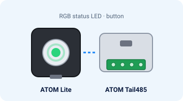
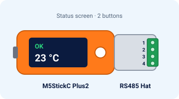
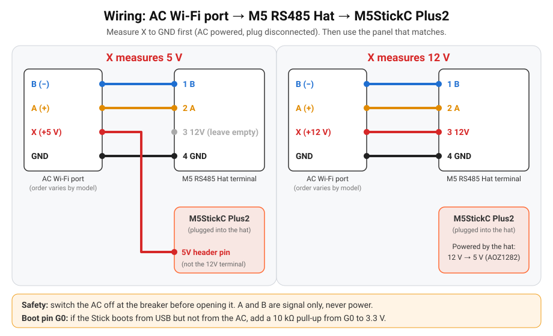
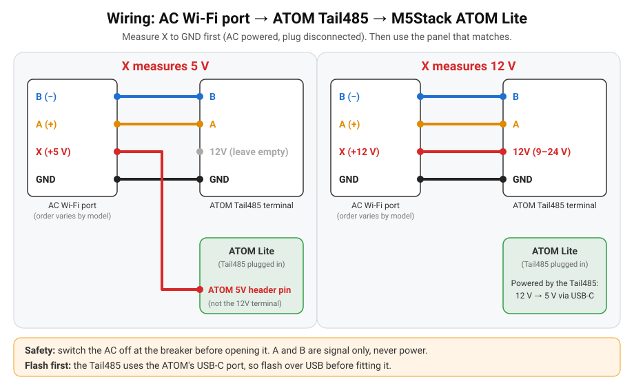

# Guia rápido

Da caixa ao Home Assistant em cerca de 15 minutos, sem YAML. *English: [quick-start.md](quick-start.md).*

## Precisas de
- Uma das duas placas (as imagens são ilustrações):

  | **ATOM Lite + ATOM Tail485** (≈ 15 US$) | **M5StickC Plus2 + RS485 Hat** (≈ 28 US$) |
  |---|---|
  |  |  |
  | LED de estado RGB e um botão | Ecrã de estado e dois botões |

- Um ar condicionado **Hisense** com o módulo Wi-Fi AEH-W4x / AEH-W41H1 ([compatibilidade](compatibility.md)).
- Um computador com **Chrome ou Edge** e um cabo USB-C **de dados** (os cabos só de carregamento não servem).
- O nome e a palavra-passe do teu Wi-Fi (rede de **2,4 GHz**).
- Um multímetro, uma chave de fendas pequena e o Home Assistant.

## 1. Instalar o firmware (2 minutos)
Faz isto **antes** de mexer no ar condicionado.
1. Abre **https://skydoy.github.io/ESPHome_AC/**.
2. Escolhe a placa: **ATOM Lite + Tail485** ou **M5StickC Plus2 + RS485 Hat**.
3. Liga a placa ao computador por USB. ATOM: sem o Tail485, que usa a mesma porta USB-C.
4. Carrega em **Install**, escolhe a porta série → **Install**.

✅ *Deves ver:* uma porta série nova na lista, depois uma barra de progresso (cerca de 1 minuto) e
"Installation complete!".

A porta não aparece? Stick: instala o controlador CH9102; ATOM: o controlador FTDI. Experimenta outro cabo.

## 2. Wi-Fi (1 minuto)
- Logo a seguir à instalação, a mesma janela pede o Wi-Fi: escolhe a rede, escreve a palavra-passe → **Connect**.
- Saltaste este passo? Com o telemóvel, liga-te à rede **`ESPHome_AC Setup`**; abre-se uma página, escolhe o teu Wi-Fi.
  Esta rede volta a aparecer sozinha sempre que a placa não consegue chegar ao Wi-Fi guardado.
- Também podes configurar o Wi-Fi por Bluetooth (Improv) a partir da app do Home Assistant.

✅ *Deves ver:* Stick: o ecrã deixa de dizer *Wi-Fi: join "ESPHome_AC Setup"* e mostra o endereço IP
(*No AC* é normal até estar ligado à máquina). ATOM: o LED passa de **azul** a **vermelho**.

## 3. Ligar ao ar condicionado (10 minutos)
> ⚠️ **Desliga primeiro o ar condicionado no disjuntor.** A unidade interior tem tensão da rede lá dentro.

1. Abre a tampa da unidade interior e desliga o módulo Wi-Fi original. Ficas com uma ficha de 4 fios:
   **A**, **B**, **GND** e **X** (alimentação).
2. **Mede o X uma vez** com o multímetro (volts DC): disjuntor ligado, ponta preta no GND, ponta vermelha no X.
   Cerca de **5 V** ou cerca de **12 V**? Volta a desligar o disjuntor. A ordem dos fios varia com o modelo,
   [vê aqui como encontrar cada fio](wiring.md#1-measure-the-plug).
3. Liga os 4 fios como no esquema e na tabela da tua placa e volta a ligar o disjuntor.

<!-- photo slot: static/photo-ac-plug.jpg (see docs/photos/README.md) -->

### M5StickC Plus2 + RS485 Hat

| Ficha do AC | X = 5 V | X = 12 V |
|---|---|---|
| A (+) | Terminal **2** do Hat | Terminal **2** do Hat |
| B (−) | Terminal **1** do Hat | Terminal **1** do Hat |
| GND | Terminal **4** do Hat | Terminal **4** do Hat |
| X | **Pino 5V** do Stick (o terminal 3 fica vazio) | Terminal **3 (12V)** do Hat |

<!-- photo slots: static/photo-stick-wiring.jpg, static/photo-stick-installed.jpg (see docs/photos/README.md) -->

✅ *Deves ver:* **OK** verde no canto superior direito do ecrã e a temperatura da sala, em menos de um minuto.

**Pino de arranque G0:** se o Stick arranca por USB mas não pelo ar condicionado, solda uma resistência de
10 kΩ entre o G0 e os 3,3 V ([detalhes](wiring.md#3-boot-pin-g0-read-this-before-closing-the-ac)).

### ATOM Lite + ATOM Tail485

| Ficha do AC | X = 5 V | X = 12 V |
|---|---|---|
| A (+) | **A** do Tail485 | **A** do Tail485 |
| B (−) | **B** do Tail485 | **B** do Tail485 |
| GND | **GND** do Tail485 | **GND** do Tail485 |
| X | **Pino 5V** do ATOM (o 12V do Tail485 fica vazio: precisa de 9–24 V) | **12V** do Tail485 |

<!-- photo slots: static/photo-atom-wiring.jpg, static/photo-atom-installed.jpg (see docs/photos/README.md) -->

✅ *Deves ver:* o LED fica **verde** em menos de um minuto (apaga-se ao fim de 30 s; carrega no botão para o ver outra vez).

O ecrã diz *No AC* ou o LED fica **vermelho**? Troca o A com o B: não há perigo, só levam sinal.

## 4. Adicionar ao Home Assistant (1 minuto)
**Definições → Dispositivos e serviços**: o **Air Conditioner** (ESPHome; **Hisense AC** em placas instaladas antes da v0.3.0) aparece em *Descobertos* → **Configurar**.
Atribui-lhe uma divisão (por exemplo, Sala).

**Teste:** põe o **Air Conditioner** em *Cool* a 24 °C e confirma que a máquina arranca.

| Entidade | Para que serve |
|---|---|
| **Air Conditioner** | Modos Off / Cool / Heat / Dry / Fan / Auto, 16–32 °C, 7 velocidades, swing, Eco, Boost, Sleep. |
| **Sensores** | Temperatura exterior e das serpentinas, compressor, humidade, tensão, potência, energia de hoje (quando a máquina os envia). |
| **AC Link**, **AC Fault** | Se a ligação à máquina está bem, e os códigos de avaria. |
| **AC Display**, **Eco**, **Super** | Luz do painel, poupança e turbo. |
| **Firmware Update**, **Auto Update** | Novas versões com um clique, ou sozinhas de madrugada. |

✅ *Deves ver:* uma entidade de clima para o ar condicionado na página do dispositivo.

Cartão para o painel e aviso de atualizações: [home-assistant.md](home-assistant.md) (em inglês).

## 5. Atualizações
As versões novas instalam-se sozinhas de madrugada. Preferes escolher? Desliga o **Auto Update** e carrega em
**Install** no **Firmware Update** quando sair uma versão nova. A página da própria placa,
`http://<ip-da-placa>/`, mostra os estados e os registos em direto.

Algo não funciona? Vê **[problemas.md](problemas.md)**.
