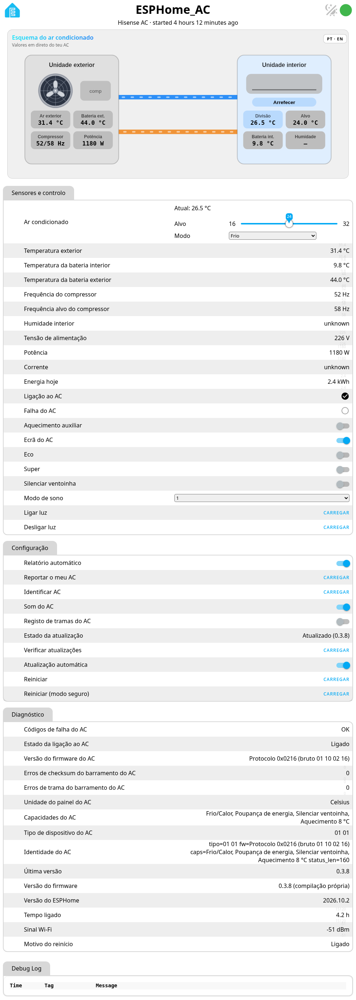
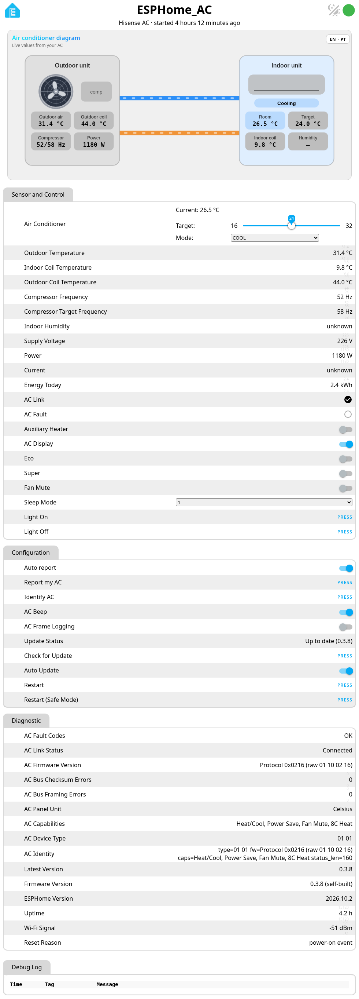

# Página web da placa

Abre `http://<ip-da-placa>/` na tua rede local para veres os estados em direto, o esquema do AC e os registos.
Sem palavra-passe de propósito (só na LAN) — vê as [notas de segurança](seguranca.md).

Língua: botão PT/EN no canto superior. Os textos de diagnóstico seguem a mesma língua.

Como ativar, proteger ou desligar o servidor web:
[Configuration → Web server](configuration.md#web-server) (em inglês).

## Capturas

  

  

English: [Device web page](web-page.md) · Voltar ao [README](../README.pt.md) · [Visão geral](visao-geral.md)
