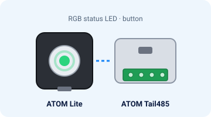
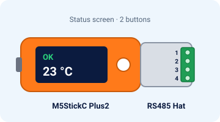
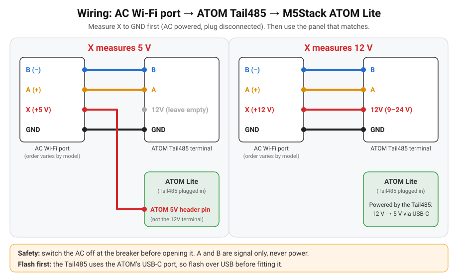

# Quick start

From the box to Home Assistant in about 15 minutes, no YAML. *Português: [guia-rapido.md](guia-rapido.md).*

## You need
- One of the two boards (pictures are illustrations):

  | **ATOM Lite + ATOM Tail485** (≈ US$15) | **M5StickC Plus2 + RS485 Hat** (≈ US$28) |
  |---|---|
  |  |  |
  | RGB status LED and a button | Status screen and two buttons |

- A **Hisense** AC with the AEH-W4x / AEH-W41H1 Wi-Fi module ([compatibility](compatibility.md)).
- A computer with **Chrome or Edge** and a USB-C **data** cable (charge-only cables do not work).
- Your home Wi-Fi name and password (**2.4 GHz** network).
- A multimeter, a small screwdriver and Home Assistant.

## 1. Flash the firmware (2 minutes)
Do this **before** going near the AC.
1. Open **https://skydoy.github.io/ESPHome_AC/**.
2. Pick your board: **ATOM Lite + Tail485** or **M5StickC Plus2 + RS485 Hat**.
3. Plug the board into your computer by USB. ATOM: without the Tail485, it uses the same USB-C port.
4. Press **Install**, pick the serial port → **Install**.

✅ *You should see:* a new serial port in the list, then a progress bar (about 1 minute) and
"Installation complete!".

Port not in the list? Stick: install the CH9102 driver; ATOM: the FTDI driver. Try another cable.

## 2. Wi-Fi (1 minute)
- Right after flashing, the same window asks for Wi-Fi: pick your network, type the password → **Connect**.
- Skipped it? From your phone join the **`ESPHome_AC Setup`** hotspot; a page opens, pick your Wi-Fi.
  The hotspot comes back on its own whenever the board cannot reach the saved Wi-Fi.
- You can also set Wi-Fi over Bluetooth (Improv) from the Home Assistant app.

✅ *You should see:* Stick: the screen stops saying *Wi-Fi: join "ESPHome_AC Setup"* and shows the
IP address (*No AC* is normal until it is wired). ATOM: the LED turns from **blue** to **red**.

## 3. Wire it to the AC (10 minutes)
> ⚠️ **Switch the AC off at the breaker first.** The indoor unit has mains voltage inside.

1. Open the indoor unit's cover and unplug the original Wi-Fi module. You are left with a 4-wire plug:
   **A**, **B**, **GND** and **X** (power).
2. **Measure X once** with a multimeter (DC volts): breaker on, black probe on GND, red probe on X.
   About **5 V** or about **12 V**? Breaker off again. Pin order varies by model,
   [here is how to find each wire](wiring.md#1-measure-the-plug).
3. Connect the 4 wires as in the diagram and table for your board, then switch the breaker back on.

<!-- photo slot: static/photo-ac-plug.jpg (see docs/photos/README.md) -->

### M5StickC Plus2 + RS485 Hat

| AC plug | X = 5 V | X = 12 V |
|---|---|---|
| A (+) | Hat terminal **2** | Hat terminal **2** |
| B (−) | Hat terminal **1** | Hat terminal **1** |
| GND | Hat terminal **4** | Hat terminal **4** |
| X | Stick **5V header pin** (terminal 3 stays empty) | Hat terminal **3 (12V)** |

<!-- photo slots: static/photo-stick-wiring.jpg, static/photo-stick-installed.jpg (see docs/photos/README.md) -->

✅ *You should see:* a green **OK** at the top right of the screen and the room temperature, within a minute.

**Boot pin G0:** if the Stick boots from USB but not from the AC, add a 10 kΩ resistor from G0 to 3.3 V
([details](wiring.md#3-boot-pin-g0-read-this-before-closing-the-ac)).

### ATOM Lite + ATOM Tail485

| AC plug | X = 5 V | X = 12 V |
|---|---|---|
| A (+) | Tail485 **A** | Tail485 **A** |
| B (−) | Tail485 **B** | Tail485 **B** |
| GND | Tail485 **GND** | Tail485 **GND** |
| X | ATOM **5V header pin** (Tail485 12V stays empty: it needs 9–24 V) | Tail485 **12V** |

<!-- photo slots: static/photo-atom-wiring.jpg, static/photo-atom-installed.jpg (see docs/photos/README.md) -->

✅ *You should see:* the LED turns **green** within a minute (it turns off after 30 s; press the button to see it again).

Screen says *No AC* or the LED stays **red**? Swap A and B: it is safe, they only carry signal.

## 4. Add it to Home Assistant (1 minute)
**Settings → Devices & services**: **Hisense AC** (ESPHome) shows up under *Discovered* → **Configure**.
Give it an area (e.g. Living room).

**Test:** set **Air Conditioner** to *Cool* at 24 °C and check the unit starts.

| Entity | What it does |
|---|---|
| **Air Conditioner** | Off / Cool / Heat / Dry / Fan / Auto, 16–32 °C, 7 fan speeds, swing, Eco, Boost, Sleep. |
| **Sensors** | Outdoor and coil temperatures, compressor, humidity, voltage, power, energy today (when the unit reports them). |
| **AC Link**, **AC Fault** | Whether the link to the unit is up, and fault codes. |
| **AC Display**, **Eco**, **Super** | Panel light, eco and turbo. |
| **Firmware Update**, **Auto Update** | New versions in one click, or by themselves at night. |

✅ *You should see:* a climate entity for the AC on the device page.

Dashboard card and update notification: [home-assistant.md](home-assistant.md).

## 5. Updates
New versions install by themselves at night. Prefer to choose? Switch **Auto Update** off and press
**Install** on **Firmware Update** when a new version is out. The device's own page,
`http://<device-ip>/`, shows states and live logs.

Something wrong? See **[troubleshooting.md](troubleshooting.md)**.
