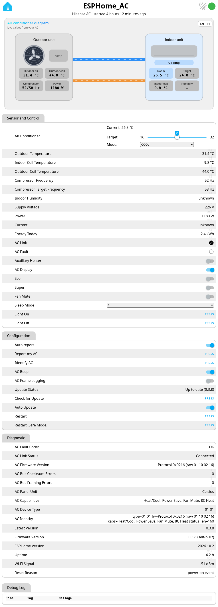
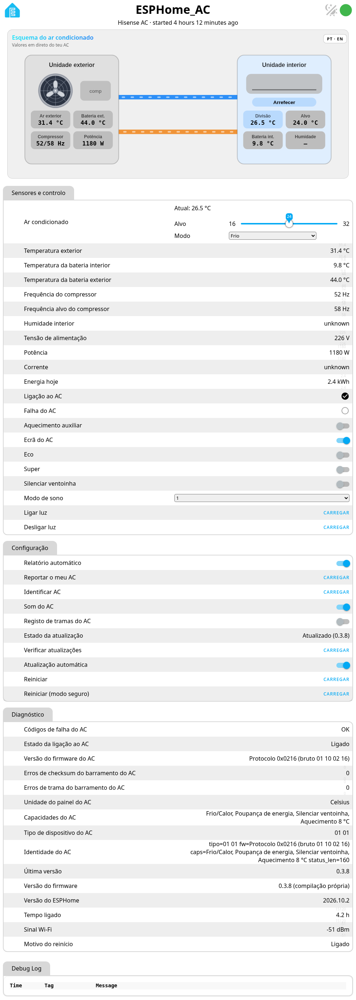

# Device web page

Open `http://<device-ip>/` on your LAN for live states, the AC diagram and logs.
No password by design (LAN only) — see [security notes](security.md).

Language: PT/EN toggle (top right). Diagnostic text values follow the same language.

How to enable, protect or turn off the web server:
[Configuration → Web server](configuration.md#web-server).

## Screenshots

  

  

Português: [Página web da placa](pagina-web.md) · Back to [README](../README.md) · [Overview](overview.md)
