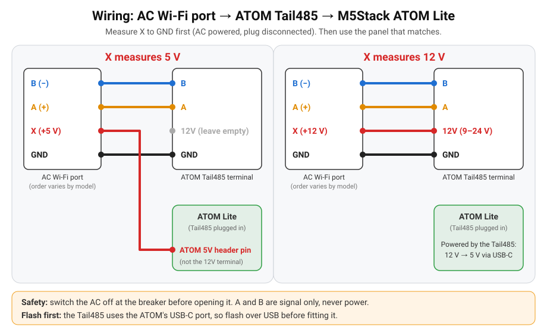

# Wiring

Two boards are supported. They speak the same protocol; only the wiring differs.

| Board | Section |
|---|---|
| M5StickC Plus2 + RS485 Hat (status screen) | [Sections 1–3](#1-measure-the-plug) below |
| M5Stack ATOM Lite + ATOM Tail485 (cheapest, status LED) | [ATOM Lite + Tail485](#atom-lite--tail485) |

> ⚠️ Switch the AC off **at the breaker** before opening the indoor unit (230 V inside).

## 1. Measure the plug
With the AC powered and the original Wi-Fi module unplugged, measure the 4 wires of the
module plug with a multimeter. Pin order varies by model, so identify them by measurement:

| Wire | How to recognise it |
|---|---|
| GND | 0 V; continuous with the chassis / cable shield |
| X (power) | about **5 V** or about **12 V** to GND |
| A (+) / B (−) | small voltage; at rest A − B reads +0.2 … +5 V |

## 2. Connect
| AC plug | X = 5 V | X = 12 V |
|---|---|---|
| A (+) | Hat terminal **2** | Hat terminal **2** |
| B (−) | Hat terminal **1** | Hat terminal **1** |
| GND | Hat terminal **4** | Hat terminal **4** |
| X | Stick **5V header pin** (hat terminal 3 stays **empty**) | Hat terminal **3 (12V)**; the AOZ1282 buck makes 5 V for the Stick |

A and B are signal only, never power. If they are swapped nothing breaks; the screen just
shows **Searching** / **No link**. Swap them.

The 12V terminal needs well above 5 V to work: never put the 5 V wire on it.

## 3. Boot pin G0 (read this before closing the AC)
The hat's TX line is **G0**, which is also an ESP32 boot strapping pin. On some setups the
Stick boots fine from USB but stays in download mode (blank screen, no Wi-Fi) when powered
from the AC.

- **Test first:** power the Stick from the AC only (USB unplugged) and check that the screen
  lights up and Wi-Fi connects.
- **Fix:** solder a **10 kΩ resistor from G0 to 3.3 V** (both on the Stick header).
- The firmware helps you spot problems:
  - the screen says `No AC: swap A/B? G0 10k pull-up?` after 60 s without a link, and the log
    prints the same hint;
  - the **Reset Reason** entity (and the screen, for 5 minutes) flags `brownout`, which means a
    weak or badly connected 5 V supply.

## Parts and pins
| Part | Notes |
|---|---|
| [M5StickC Plus2](https://docs.m5stack.com/en/core/M5StickC%20PLUS2) | ESP32-PICO-V3-02, HOLD = G4 (kept HIGH by the firmware) |
| [M5 RS485 Hat (U067)](https://docs.m5stack.com/en/hat/hat_rs485) | SP485EEN transceiver (auto direction), AOZ1282CI 12 V → 5 V buck |
| UART | TX = **G0**, RX = **G26**, 9600 8N1 |

## ATOM Lite + Tail485

1. **Flash first.** The Tail485 plugs into the ATOM's USB-C port (that is how it powers the
   ATOM) and its Grove port. Flash the ATOM over USB from the web installer *before* fitting the
   Tail485; later updates go over the air.
2. **Measure** the plug as in [section 1](#1-measure-the-plug).
3. **Connect** one 4-core cable from the AC plug:

| AC plug | X = 5 V | X = 12 V |
|---|---|---|
| B (−) | Tail485 **B** | Tail485 **B** |
| A (+) | Tail485 **A** | Tail485 **A** |
| GND | Tail485 **GND** | Tail485 **GND** |
| X | ATOM **5V header pin** (Tail485 12V stays **empty**) | Tail485 **12V** |

**Why X does not go to the Tail485 12V terminal at 5 V:** that terminal feeds a buck converter
rated for **9–24 V**. At 5 V it drops out and the ATOM browns out. The buck's 5 V output is the
same net as the ATOM's 5V rail (through the USB-C plug and the Grove 5V pin), so feeding the
AC's 5 V straight into the ATOM's **5V** header socket powers both boards. GND is shared
through the Tail485's GND terminal, Grove and USB-C. Use one crimped male Dupont pin on the X
wire, the same trick as the Stick. Do not connect anything to the 12V terminal in this case.

**12 V units** are a true single-cable job: all four wires go into the Tail485 terminal.

If the LED stays **red** with Wi-Fi up, swap A and B. TX/RX use G26/G32, which are not boot
strapping pins, so the Stick's G0 pull-up issue does not apply here.

### Status LED and button
| LED | Meaning |
|---|---|
| Blue | Wi-Fi not connected (setup hotspot `Hisense-AC Setup` / Improv) |
| Red | Wi-Fi OK, no AC link (check A/B and power) |
| Green | AC link OK; turns off after 30 s (stays on for the first 5 minutes after boot) |
| White | Button held: keep holding for a factory reset; fast blink = reset imminent |

Short press: show the status again. Hold **10 s**: factory reset (Wi-Fi and settings erased,
back to setup mode). Release earlier to cancel. Red and blue stay on until fixed.

### ATOM pins (from the M5Stack docs)
| Part | Notes |
|---|---|
| [ATOM Lite](https://docs.m5stack.com/en/core/ATOM%20Lite) | ESP32-PICO-D4, 4 MB flash; SK6812 LED = **G27**, button = **G39**, IR LED = G12 (unused) |
| [ATOM Tail485 (T002)](https://docs.m5stack.com/en/atom/tail485) | RS-485 transceiver with automatic direction, 9–24 V → 5 V buck (AOZ1282), terminal B / A / 12V / GND |
| UART | TX = **G26**, RX = **G32**, 9600 8N1 |

The [ATOMIC RS485 Base](https://docs.m5stack.com/en/atom/Atomic%20RS485%20Base) also works but
uses other pins (TX = G19, RX = G22; override `ac_tx_pin` / `ac_rx_pin`) and its input needs
6–24 V.

More detail on the Hisense port: [brands/hisense/hardware.md](../brands/hisense/hardware.md).
