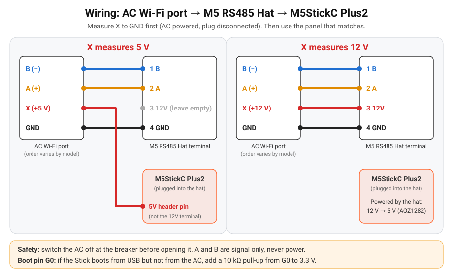

# Wiring

> ⚠️ Switch the AC off **at the breaker** before opening the indoor unit (230 V inside).

## 1. Measure the plug
With the AC powered and the original Wi-Fi module unplugged, measure the 4 wires of the
module plug with a multimeter. Pin order varies by model, so identify them by measurement:

| Wire | How to recognise it |
|---|---|
| GND | 0 V; continuous with the chassis / cable shield |
| X (power) | about **5 V** or about **12 V** to GND |
| A (+) / B (−) | small voltage; at rest A − B reads +0.2 … +5 V |

## 2. Connect
| AC plug | X = 5 V | X = 12 V |
|---|---|---|
| A (+) | Hat terminal **2** | Hat terminal **2** |
| B (−) | Hat terminal **1** | Hat terminal **1** |
| GND | Hat terminal **4** | Hat terminal **4** |
| X | Stick **5V header pin** (hat terminal 3 stays **empty**) | Hat terminal **3 (12V)**; the AOZ1282 buck makes 5 V for the Stick |

A and B are signal only, never power. If they are swapped nothing breaks; the screen just
shows **Searching** / **No link**. Swap them.

The 12V terminal needs well above 5 V to work: never put the 5 V wire on it.

## 3. Boot pin G0 (read this before closing the AC)
The hat's TX line is **G0**, which is also an ESP32 boot strapping pin. On some setups the
Stick boots fine from USB but stays in download mode (blank screen, no Wi-Fi) when powered
from the AC.

- **Test first:** power the Stick from the AC only (USB unplugged) and check that the screen
  lights up and Wi-Fi connects.
- **Fix:** solder a **10 kΩ resistor from G0 to 3.3 V** (both on the Stick header).
- The firmware helps you spot problems:
  - the screen says `No AC: swap A/B? G0 10k pull-up?` after 60 s without a link, and the log
    prints the same hint;
  - the **Reset Reason** entity (and the screen, for 5 minutes) flags `brownout`, which means a
    weak or badly connected 5 V supply.

## Parts and pins
| Part | Notes |
|---|---|
| [M5StickC Plus2](https://docs.m5stack.com/en/core/M5StickC%20PLUS2) | ESP32-PICO-V3-02, HOLD = G4 (kept HIGH by the firmware) |
| [M5 RS485 Hat (U067)](https://docs.m5stack.com/en/hat/hat_rs485) | SP485EEN transceiver (auto direction), AOZ1282CI 12 V → 5 V buck |
| UART | TX = **G0**, RX = **G26**, 9600 8N1 |

More detail on the Hisense port: [brands/hisense/hardware.md](../brands/hisense/hardware.md).
