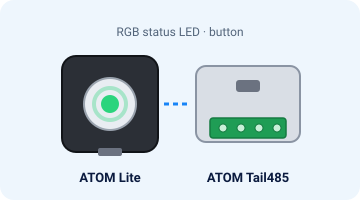
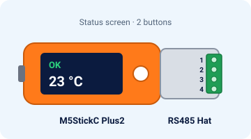

# Getting started

About 15 minutes from the box to Home Assistant. No YAML.

## You need

- One of the two boards below. The pictures are illustrations, not photos of a fitted unit.
- A **Hisense** AC with the AEH-W4x / AEH-W41H1 Wi-Fi module. See [compatibility](compatibility.md).
- A computer with **Chrome or Edge** and a USB-C **data** cable. Charge-only cables do not work.
- Your home Wi-Fi name and password (**2.4 GHz**).
- A multimeter, a small screwdriver and Home Assistant.

## Boards at a glance

| | **ATOM Lite + ATOM Tail485** | **M5StickC Plus2 + RS485 Hat** |
|---|---|---|
| Picture | { width="280" } | { width="280" } |
| Approx. price | ≈ US$15 (US$7.50 + US$6.95) | ≈ US$28 (US$19.95 + ≈ US$8) |
| Status | RGB LED and a button | Screen and two buttons |
| Shop links | [ATOM Lite](https://docs.m5stack.com/en/core/ATOM%20Lite) · [Tail485](https://docs.m5stack.com/en/atom/tail485) | [M5StickC Plus2](https://docs.m5stack.com/en/core/M5StickC%20PLUS2) · [RS485 Hat](https://docs.m5stack.com/en/hat/hat_rs485) |

Prices are M5Stack shop list prices, before shipping and tax. The Plus2 is end-of-life at the M5Stack shop.

!!! warning "Stick boot pin G0"
    If the Stick boots from USB but not from the AC, add a 10 kΩ pull-up from G0 to 3.3 V before you close the unit. [Details](wiring.md#3-boot-pin-g0-read-this-before-closing-the-ac).

!!! note "ATOM hardware"
    The ATOM build is checked automatically. It has not been tested on a real unit yet. [Open questions](open-questions.md).

## Next

1. [Install](install.md) the firmware
2. [Wire](wiring.md) the 4-wire plug (breaker off)
3. Add it in [Home Assistant](home-assistant.md)

The longer walkthrough, including empty photo slots, is still in the repository: [docs/quick-start.md](https://github.com/skydoy/ESPHome_AC/blob/main/docs/quick-start.md). Real photos are not in the repository yet ([docs/photos/README.md](https://github.com/skydoy/ESPHome_AC/blob/main/docs/photos/README.md)).
