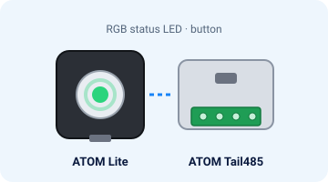
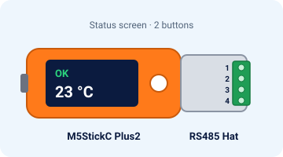

# Primeiros passos

Cerca de 15 minutos da caixa ao Home Assistant. Sem YAML.

## Precisas de

- Uma das duas placas abaixo. As imagens são ilustrações, não fotos de uma máquina montada.
- Um ar condicionado **Hisense** com o módulo Wi-Fi AEH-W4x / AEH-W41H1. Vê a [compatibilidade](compatibility.md).
- Um computador com **Chrome ou Edge** e um cabo USB-C **de dados**. Cabos só de carregamento não servem.
- O nome e a palavra-passe do teu Wi-Fi (rede de **2,4 GHz**).
- Um multímetro, uma chave de fendas pequena e o Home Assistant.

## Placas em resumo

| | **ATOM Lite + ATOM Tail485** | **M5StickC Plus2 + RS485 Hat** |
|---|---|---|
| Imagem | { width="280" } | { width="280" } |
| Preço aprox. | ≈ 15 US$ (7,50 + 6,95) | ≈ 28 US$ (19,95 + ≈ 8) |
| Estado | LED RGB e um botão | Ecrã e dois botões |
| Fichas técnicas | [ATOM Lite](https://docs.m5stack.com/en/core/ATOM%20Lite) · [Tail485](https://docs.m5stack.com/en/atom/tail485) | [M5StickC Plus2](https://docs.m5stack.com/en/core/M5StickC%20PLUS2) · [RS485 Hat](https://docs.m5stack.com/en/hat/hat_rs485) |

Preços de tabela da loja M5Stack, sem portes nem impostos. O Plus2 foi descontinuado na loja M5Stack.

!!! warning "Pino de arranque G0 no Stick"
    Se o Stick arranca por USB mas não pelo ar condicionado, solda uma resistência de 10 kΩ entre o G0 e os 3,3 V antes de fechares a máquina. [Detalhes](wiring.md#3-pino-de-arranque-g0-le-isto-antes-de-fechares-o-ar-condicionado).

!!! note "Hardware do ATOM"
    A versão ATOM é verificada automaticamente. Ainda não foi testada numa máquina real. [Questões em aberto](open-questions.md).

## A seguir

1. [Instala](install.md) o firmware
2. [Liga](wiring.md) a ficha de 4 fios (disjuntor desligado)
3. Adiciona-a no [Home Assistant](home-assistant.md)

O passo a passo mais longo, com marcas para fotos que ainda não existem, continua no repositório: [docs/guia-rapido.md](https://github.com/skydoy/ESPHome_AC/blob/main/docs/guia-rapido.md). Ainda não há fotos reais no repositório ([docs/photos/README.md](https://github.com/skydoy/ESPHome_AC/blob/main/docs/photos/README.md)).
