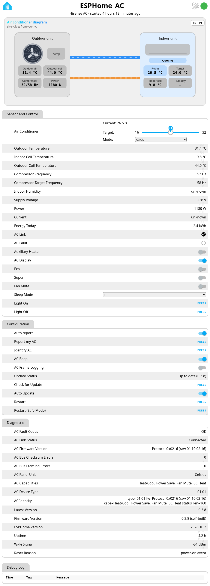
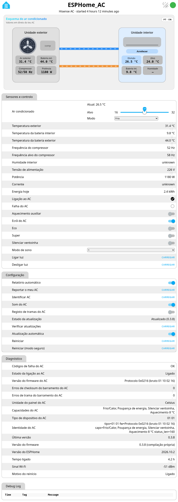

# Device web page

Open `http://<device-ip>/` on your LAN for live states, the AC diagram and logs.
There is no password, on purpose (LAN only). See [security](security.md).

Language: PT/EN toggle at the top right. Diagnostic text values follow the same language.

How to enable, protect or turn the web server off: [Configuration → Web server](configuration.md#web-server).

## Screenshots

{ width="640" }

{ width="640" }

Repository copy: [docs/web-page.md](https://github.com/skydoy/ESPHome_AC/blob/main/docs/web-page.md).
