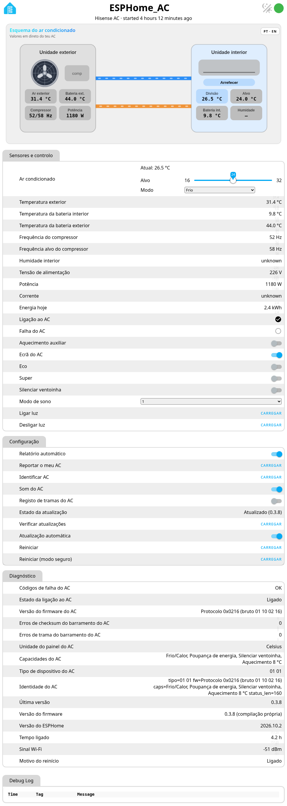
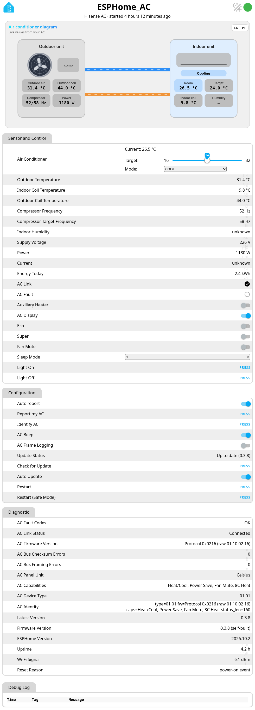

# Página web da placa

Abre `http://<ip-da-placa>/` na tua rede local para veres os estados em direto, o esquema do AC e os registos.
Não há palavra-passe, de propósito (só na LAN). Vê a [segurança](security.md).

Língua: botão PT/EN no canto superior. Os textos de diagnóstico seguem a mesma língua.

Como ativar, proteger ou desligar o servidor web: [Configuração → Servidor web](configuration.md#servidor-web).

## Capturas

{ width="640" }

{ width="640" }

O guia no GitHub: [docs/pagina-web.md](https://github.com/skydoy/ESPHome_AC/blob/main/docs/pagina-web.md).
