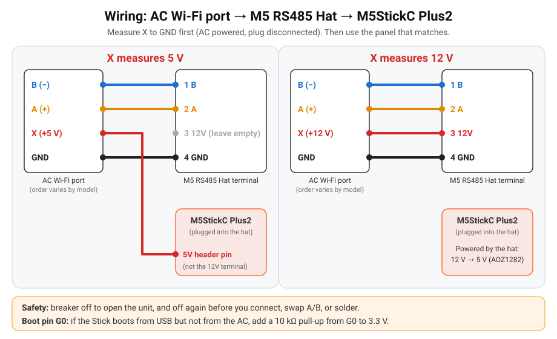
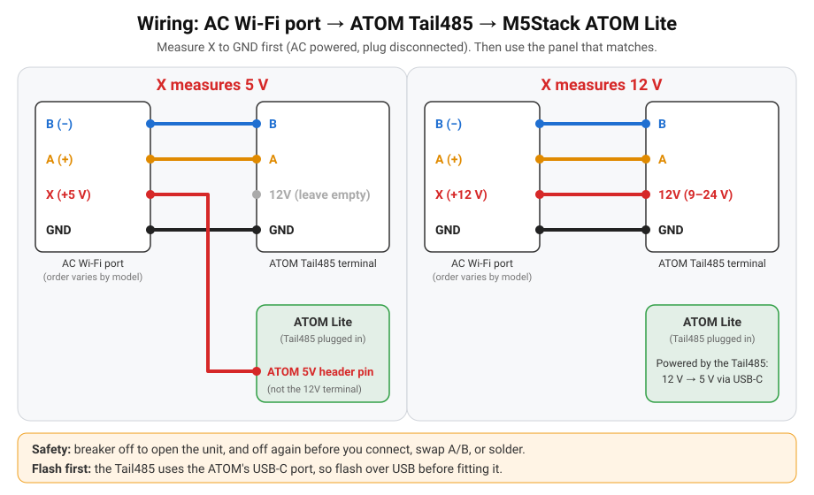

# Ligações

Há duas placas. Falam o mesmo protocolo; só as ligações mudam.

| Placa | Secção |
|---|---|
| M5StickC Plus2 + RS485 Hat (ecrã de estado) | [Secções 1–3](#1-medir-a-ficha) |
| M5Stack ATOM Lite + ATOM Tail485 (LED de estado) | [ATOM Lite + Tail485](#atom-lite-tail485) |

!!! warning "Tensão da rede"
    Desliga o ar condicionado **no disjuntor** antes de abrires a unidade interior (230 V lá dentro).

## 1. Medir a ficha

Disjuntor desligado antes de abrires a unidade interior. Depois, com o ar condicionado ligado e o módulo Wi-Fi original desligado, mede os 4 fios com um multímetro. A ordem dos pinos varia com o modelo, por isso identifica-os pela medição, não por uma ordem adivinhada. **Volta a desligar o disjuntor** assim que tiveres a leitura, antes de ligares o que quer que seja.

| Fio | Como o reconheces |
|---|---|
| GND | 0 V; continuidade com o chassis / blindagem do cabo |
| X (alimentação) | cerca de **5 V** ou cerca de **12 V** em relação ao GND |
| A (+) / B (−) | tensão pequena; em repouso A − B lê +0,2 … +5 V |

Uma nota no repositório indica uma ordem **típica** do módulo (1 = +5 V, 2 = A, 3 = B, 4 = GND) e diz para a confirmares. Usa isso só como pista. [hardware.md](https://github.com/skydoy/ESPHome_AC/blob/main/brands/hisense/hardware.md)

## 2. Ligar

!!! warning "Disjuntor desligado"
    O disjuntor fica desligado antes de ligares um fio, trocares o A com o B, ou soldares. Só o voltas a ligar quando os fios estão no sítio e já não estás dentro da máquina.

| Ficha do AC | X = 5 V | X = 12 V |
|---|---|---|
| A (+) | Terminal **2** do Hat | Terminal **2** do Hat |
| B (−) | Terminal **1** do Hat | Terminal **1** do Hat |
| GND | Terminal **4** do Hat | Terminal **4** do Hat |
| X | **Pino 5V** do Stick (o terminal 3 do Hat fica **vazio**) | Terminal **3 (12V)** do Hat; o conversor AOZ1282 faz os 5 V do Stick |

A e B são só sinal, nunca alimentação. Se os trocares, nada se estraga; o ecrã mostra **Searching** / **No link**. Disjuntor desligado, troca-os, disjuntor ligado.

O terminal 12V precisa de bem mais do que 5 V para funcionar. Nunca ligues aí o fio de 5 V.

## 3. Pino de arranque G0 (lê isto antes de fechares o ar condicionado)

A linha TX do Hat é o **G0**, que também é um pino de arranque do ESP32. Nalguns casos o Stick arranca por USB mas fica em modo de programação (ecrã apagado, sem Wi-Fi) quando é alimentado pelo ar condicionado.

- **Testa primeiro:** alimenta o Stick só pelo ar condicionado (USB desligado) e confirma que o ecrã acende e o Wi-Fi liga.
- **Depois desliga o disjuntor** antes de soldares.
- **Correção:** solda uma **resistência de 10 kΩ entre o G0 e os 3,3 V** (os dois no conector do Stick).
- O firmware ajuda-te a ver o problema:
    - o ecrã diz `No AC: swap A/B? G0 10k pull-up?` ao fim de 60 s sem ligação, e o registo escreve a mesma pista;
    - a entidade **Reset Reason** (e o ecrã, durante 5 minutos) marca `brownout`, que significa uma alimentação de 5 V fraca ou mal ligada.

## Peças e pinos

| Peça | Notas |
|---|---|
| [M5StickC Plus2](https://docs.m5stack.com/en/core/M5StickC%20PLUS2) | ESP32-PICO-V3-02, HOLD = G4 (o firmware mantém-no em HIGH) |
| [M5 RS485 Hat (U067)](https://docs.m5stack.com/en/hat/hat_rs485) | Transceiver SP485EEN (direção automática), conversor AOZ1282CI de 12 V para 5 V |
| UART | TX = **G0**, RX = **G26**, 9600 8N1 |

## ATOM Lite + Tail485

1. **Grava primeiro.** O Tail485 entra na porta USB-C do ATOM (é assim que o alimenta) e na porta Grove. Grava o ATOM por USB a partir do instalador web *antes* de encaixares o Tail485. As atualizações seguintes vão pelo ar.
2. **Mede** a ficha como na [secção 1](#1-medir-a-ficha). Disjuntor outra vez desligado antes do passo seguinte.
3. **Liga** um cabo de 4 condutores a partir da ficha do AC, com o disjuntor desligado:

| Ficha do AC | X = 5 V | X = 12 V |
|---|---|---|
| B (−) | **B** do Tail485 | **B** do Tail485 |
| A (+) | **A** do Tail485 | **A** do Tail485 |
| GND | **GND** do Tail485 | **GND** do Tail485 |
| X | **Pino 5V** do ATOM (o 12V do Tail485 fica **vazio**) | **12V** do Tail485 |

**Porque é que o X não vai ao terminal 12V do Tail485 quando há 5 V:** esse terminal alimenta um conversor previsto para **9–24 V**. A 5 V deixa de regular e o ATOM entra em brownout. A saída de 5 V do conversor é a mesma rede que os 5 V do ATOM (pela ficha USB-C e pelo pino 5V do Grove), por isso meter os 5 V do AC diretamente no pino **5V** do ATOM alimenta as duas placas. O GND é comum pelo terminal GND do Tail485, pelo Grove e pelo USB-C. Usa um pino Dupont macho cravado no fio X. Neste caso não ligues nada ao terminal 12V.

**Unidades de 12 V:** os quatro fios entram no terminal do Tail485.

Se o LED ficar **vermelho** com o Wi-Fi ligado, desliga o disjuntor, troca o A com o B e volta a ligá-lo. TX/RX usam G26/G32, que não são pinos de arranque, por isso o pull-up do G0 do Stick não se aplica aqui.

### LED e botão de estado

| LED | Significado |
|---|---|
| Azul | Wi-Fi desligado (rede de configuração `ESPHome_AC Setup` / Improv) |
| Vermelho | Wi-Fi OK, sem ligação ao AC (verifica A/B e a alimentação) |
| Verde | Ligação ao AC OK; apaga-se ao fim de 30 s (fica aceso nos primeiros 5 minutos depois do arranque) |
| Branco | Botão carregado: continua a carregar para a reposição de fábrica; piscar rápido = a reposição está iminente |

Toque curto: mostra outra vez o estado. Mantém **10 s**: reposição de fábrica (apaga o Wi-Fi e as definições e volta ao modo de configuração). Larga antes para cancelar. Vermelho e azul ficam acesos até estar resolvido.

### Pinos do ATOM (documentação M5Stack)

| Peça | Notas |
|---|---|
| [ATOM Lite](https://docs.m5stack.com/en/core/ATOM%20Lite) | ESP32-PICO-D4, 4 MB de flash; LED SK6812 = **G27**, botão = **G39**, LED IR = G12 (não usado) |
| [ATOM Tail485 (T002)](https://docs.m5stack.com/en/atom/tail485) | Transceiver RS-485 com direção automática, conversor 9–24 V para 5 V (AOZ1282), terminal B / A / 12V / GND |
| UART | TX = **G26**, RX = **G32**, 9600 8N1 |

A [ATOMIC RS485 Base](https://docs.m5stack.com/en/atom/Atomic%20RS485%20Base) também funciona, mas usa outros pinos (TX = G19, RX = G22; sobrepõe `ac_tx_pin` / `ac_rx_pin`) e a entrada precisa de 6–24 V.

Mais sobre a porta Hisense: [brands/hisense/hardware.md](https://github.com/skydoy/ESPHome_AC/blob/main/brands/hisense/hardware.md). O guia de ligações no GitHub está só em inglês: [docs/wiring.md](https://github.com/skydoy/ESPHome_AC/blob/main/docs/wiring.md).
